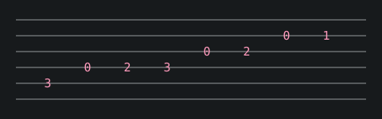

Scales are to music what unit tests are to code: nobody enjoys them, and everything is easier once they are there.



I keep a practice log the same way I keep a changelog, and I run it like a test suite every morning:

```sh
# practice.sh: five minutes, every day, before anything fun
for key in C G D A E; do
  echo "major scale in $key, 60 bpm"
  sleep 60
done
```

The trick that finally worked: never skip the boring part, but keep it short enough that skipping it would feel silly.
