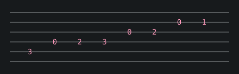

Nobody enjoys practising scales, just as nobody enjoys writing unit tests, but in both cases everything gets easier once they're in place.



I keep a practice log the same way I keep a changelog. Every morning I run the scales like a test suite, five minutes before I play anything fun:

```sh
# practice.sh: five minutes, every day, before anything fun
for key in C G D A E; do
  echo "major scale in $key, 60 bpm"
  sleep 60
done
```

The habit stuck once I made the scales short enough that skipping them would feel silly. Now I never skip them.
